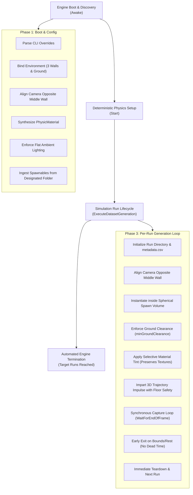
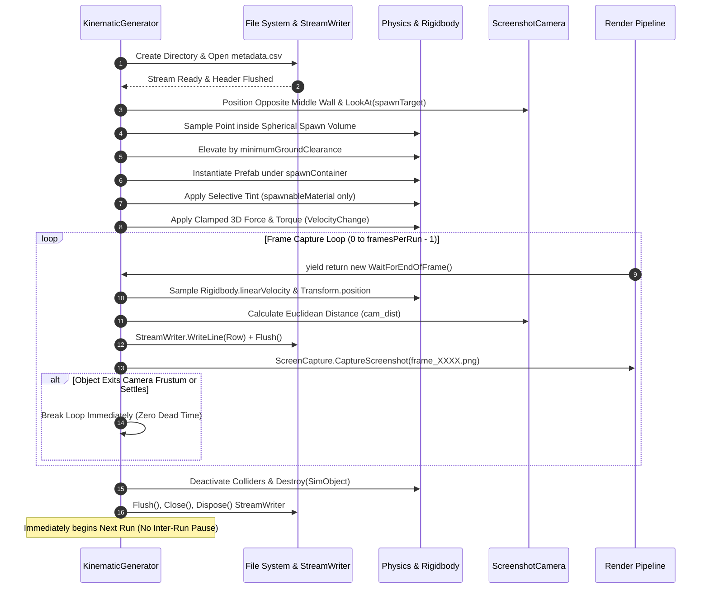

# KinematicGenerator Architecture & Dataflow Specification

This document provides a comprehensive yet concise specification of the dataflow, runtime lifecycle, and mathematical transformations implemented in [`KinematicGenerator.cs`](file:///Users/nicholas/KinematicDatasetFinal/Assets/Scripts/KinematicGenerator.cs).

---

## 1. High-Level Pipeline Architecture

The system operates as an autonomous, headless-ready data generation pipeline structured into four deterministic phases:



---

## 2. Detailed Dataflow by Lifecycle Phase

### Phase 1: Initialization & Environment Configuration (`Awake`)

1. **CLI Parameter Ingestion:**
   - Scans `Environment.GetCommandLineArgs()`.
   - Overrides default parameters when launched in headless/batchmode (`-targetRuns`, `-framesPerRun`, `-capturesPerSecond`, `-outputDirectory`, `-spawnablesDirectory`).
2. **Environment Geometry Binding (3 Walls & Ground):**
   - References `ground`, `middleWall`, `leftWall`, and `rightWall`.
   - Auto-discovers them in the scene if unassigned (`Ground`, `CenterWall`/`MiddleWall`, `LeftWall`, `RightWall`).
   - Supports optional material overrides (`groundMaterial`, `middleWallMaterial`, `leftWallMaterial`, `rightWallMaterial`).
3. **Camera Automatic Alignment:**
   - Positions `screenshotCamera` strictly **opposite of the middle wall**, facing towards `spawnContainer`:
     $$\vec{d}_{\text{wall}\to\text{spawn}} = (\vec{p}_{\text{spawn}} - \vec{p}_{\text{wall}})_{xz}.\text{normalized}$$
     $$\vec{p}_{\text{cam}} = \vec{p}_{\text{spawn}} + \vec{d}_{\text{wall}\to\text{spawn}} \times d_{\text{cam}} + \hat{y} \times h_{\text{camOffset}}$$
     $$\text{Camera.LookAt}(\vec{p}_{\text{spawn}})$$
   - Automatically re-evaluates in `OnValidate()` in the Unity Editor when moving objects or adjusting distances.
4. **Procedural Physics Material Synthesis:**
   - Constructs an in-memory `PhysicsMaterial` with zero inspector dependencies:
     $$\mu_d = 0.6, \quad \mu_s = 0.6, \quad e = 0.3, \quad \text{Combine Mode} = \text{Average}$$
5. **Photometric Shadow Deprecation:**
   - Disables shadow casting on all directional lights (`light.shadows = LightShadows.None`).
   - Sets `RenderSettings.ambientMode = AmbientMode.Flat` ($\text{RGB} = [0.9, 0.9, 0.9]$), isolating point spread motion blur from occluding shadow contours.
6. **Designated Spawnables Directory Ingestion:**
   - Automatically loads all `.prefab` assets from `spawnablesDirectory` (default `Assets/Spawnables`).
   - In Editor mode: uses `AssetDatabase.FindAssets("t:Prefab", new[] { spawnablesDirectory })`.
   - In standalone mode: loads from `Resources/Spawnables`.

---

### Phase 2: Deterministic Physics Synchronization (`Start`)

To eliminate temporal drift between variable render intervals and physics integration, the pipeline enforces strict sub-stepping:

$$\Delta t_{\text{render}} = \frac{1}{\text{capturesPerSecond}}$$

$$\Delta t_{\text{physics}} = \frac{1}{\text{capturesPerSecond} \times \text{oversampleMultiplier}} = \frac{\Delta t_{\text{render}}}{4}$$

* **Framerate Lock:** `Time.captureFramerate = capturesPerSecond;`
* **Solver Precision:** Sets `Physics.defaultSolverIterations = 50` and `Physics.defaultSolverVelocityIterations = 50`.

---

### Phase 3: Per-Run Generation & Spherical Spawn Lifecycle (`ExecuteDatasetGeneration`)



#### Step-by-Step Operations:

1. **Storage Setup:**
   - Allocates run directory: `<OutputDirectory>/<SessionTimestamp>_Run_<runIndex:D3>/`.
   - Initializes `StreamWriter` with UTF-8 encoding and writes schema header row:
     ```csv
     frame_id,timestamp,kind,pos_x,pos_y,pos_z,vel_mag,vel_dir_x,vel_dir_y,vel_dir_z,cam_dist,blur_intensity
     ```
2. **Camera Orientation:**
   - Automatically snaps opposite the middle wall facing the spawn container.
3. **Adjustable Spherical Spawn Volume & Ground Clearance:**
   - Evaluates spawn origin: $\vec{p}_{\text{origin}} = \vec{p}_{\text{container}} + \hat{y} \times \text{spawnElevationOffset}$.
   - Samples random 3D position within spherical volume:
     $$\vec{p}_{\text{spawn}} = \vec{p}_{\text{origin}} + \vec{u}_{\text{sphere}} \times r, \quad r \in [\text{minSpawnRadius}, \text{spawnRadius}]$$
   - **Ground Clearance Enforcement:** Evaluates `GetObjectBottomY()`. If $\text{bounds.min.y} < \text{minimumGroundClearance}$ ($3.0\text{m}$), the instance is pushed upward to guarantee it never intersects the floor.
   - **Interactive Scene Gizmo:** Draws a real-time visible sphere in the Scene view with inner deadzone and alignment vectors as you adjust ranges in the Inspector.
4. **Selective Material Tinting (Texture Preservation):**
   - Scans all child renderers and material slots.
   - If a material matches `spawnableMaterial` (e.g., `FallingObject`), a cloned material instance is tinted with a random color (`_BaseColor` and `_Color`).
   - If an object uses distinct textures (e.g., office supplies, stationery), its textures and materials are **left 100% intact**.
5. **Kinematic Trajectory Impartation & Floor-Pulling Safeguard:**
   - Resets linear and angular velocities to zero (`linearVelocity = Vector3.zero`).
   - Calculates primary trajectory vector: $\vec{u}_{\text{target}} = \frac{\vec{p}_{\text{focal}} - \vec{p}_0}{\|\vec{p}_{\text{focal}} - \vec{p}_0\|_2}$.
   - **Trajectory Clamp:** Clamps downward angle (`minTrajectoryAngleY = -0.35f`) so downward impulse does not slam the object directly into the floor.
   - Multi-axis impulse applied via `ForceMode.VelocityChange`.
   - Random angular torque applied to induce tumbling.

---

### Phase 4: Synchronous Telemetry Extraction & Pause Elimination (`RunCaptureLoop`)

The capture loop executes strictly at the end of each rendered frame via `yield return new WaitForEndOfFrame()`, guaranteeing mathematical synchronization between pixel blur and physical ground truth:

#### Ground Truth Formulations:
1. **Instantaneous Velocity Magnitude:**
   $$v_{\text{mag}} = \|\vec{v}\|_2 = \sqrt{v_x^2 + v_y^2 + v_z^2}$$
2. **Normalized 3D Direction Vector:**
   $$\vec{d} = \begin{cases} \frac{\vec{v}}{\|\vec{v}\|_2}, & \text{if } \|\vec{v}\|_2 > 10^{-6} \\ \vec{0}, & \text{otherwise} \end{cases}$$
3. **Simulated Proximity / LiDAR Distance:**
   $$d_{\text{cam}} = \|\vec{p}_{\text{cam}} - \vec{p}_{\text{obj}}\|_2$$
4. **Pause Elimination (Dynamic Run Termination):**
   - **Out-of-Bounds Detection:** Evaluates camera frustum planes via `GeometryUtility.TestPlanesAABB` and minimum Y bound (`minimumYBound = -4.0f`). If the object has left view, the run terminates immediately without saving redundant blank frames.
   - **Resting State Detection:** If velocity falls below `restVelocityThreshold` ($0.15\text{ m/s}$) for `maxRestFrames` consecutive frames, the object has settled; the run terminates immediately without capturing static frames.
   - **Immediate Inter-Run Transition:** Colliders are deactivated prior to destruction (`col.enabled = false`), eliminating residual physics overlap, and the next run begins immediately.

---

### Phase 5: Run Teardown & Engine Termination

1. **Teardown Current Run:**
   - Closes and flushes `StreamWriter`.
   - Deactivates colliders and destroys active simulation `GameObject`.
2. **Automated Engine Exit:**
   - Upon completing `targetRuns`, automatically shuts down execution:
     - Editor: `UnityEditor.EditorApplication.isPlaying = false;`
     - Standalone / Headless: `Application.Quit();`
3. **Stream Lifecycle Safety:**
   - Redundant resource cleanup registered in `OnDisable()`, `OnDestroy()`, and `OnApplicationQuit()` to prevent dangling OS file handles.

---

## 3. Data Schema Specification

### File Hierarchy
```text
<OutputDirectory>/
└── <SessionTimestamp>_Run_<RunIndex:D3>/
    ├── metadata.csv
    ├── frame_0000.png
    ├── frame_0001.png
    └── ...
```

### `metadata.csv` Schema
```csv
frame_id,timestamp,kind,pos_x,pos_y,pos_z,vel_mag,vel_dir_x,vel_dir_y,vel_dir_z,cam_dist,blur_intensity
```
